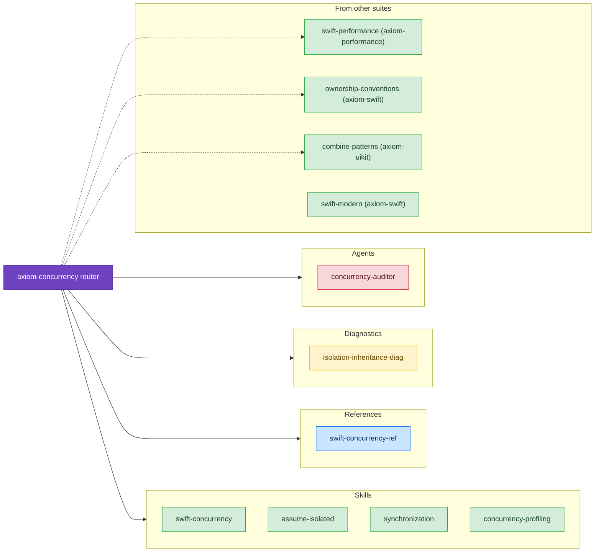

# Concurrency & Async

Skills for Swift concurrency: async/await, actors, `Sendable`, and the compile-time data-race checking in Swift 6. This section also collects the Swift language skills that sit beside concurrency: performance, ownership, modern idioms, and Combine.

Solid arrows lead to skills in the `axiom-concurrency` suite. Dotted arrows lead to skills in other suites that the router points to; Modern Swift Idioms belongs to `axiom-swift` and is listed here because it covers the same code.

## Skills

- **[Swift Concurrency](/skills/concurrency/swift-concurrency)** – Swift 6 strict concurrency: async/await, `@MainActor`, `Sendable`, and actor isolation
  - *"I'm getting 'Main actor-isolated property accessed from nonisolated context' errors everywhere."*
  - *"My code is throwing 'Type does not conform to Sendable' warnings when passing data between threads."*
  - *"I have a stored task causing memory leaks. How do I write it correctly with weak self?"*

- **[Swift Concurrency Reference](/reference/swift-concurrency-ref)** – API reference for actors, `Sendable`, `Task` and `TaskGroup`, `AsyncStream`, continuations, and migration patterns
  - *"How do I create a TaskGroup?"*
  - *"What's the AsyncStream continuation API?"*
  - *"How do I convert completion handlers to async?"*

- **[Runtime Isolation Crash Diagnostics](/diagnostic/isolation-inheritance-diag)** – Production crashes in warning-free Swift 6 builds, with `_dispatch_assert_queue_fail` or `_swift_task_checkIsolatedSwift` in the crash report
  - *"My Swift 6 build has zero warnings but crashes in production with _dispatch_assert_queue_fail."*
  - *"Why does my CLLocationManager delegate method crash with _swift_task_checkIsolatedSwift?"*

- **[assumeIsolated](/skills/concurrency/assume-isolated)** – Synchronous actor access for tests, legacy callbacks, and performance-critical code
  - *"How do I access MainActor state from a delegate callback that runs on the main thread?"*
  - *"What's the difference between Task { @MainActor in } and MainActor.assumeIsolated?"*

- **[Synchronization](/skills/concurrency/synchronization)** – Thread-safe primitives: `Mutex` (iOS 18+), `OSAllocatedUnfairLock`, and atomic types
  - *"Should I use Mutex or an actor for this hot path?"*
  - *"What's the difference between os_unfair_lock and OSAllocatedUnfairLock?"*

- **[Concurrency Profiling](/skills/concurrency/concurrency-profiling)** – Instruments workflows for async/await performance
  - *"My async code is slow. How do I profile it?"*
  - *"I think I have actor contention. How do I diagnose it?"*

- **[Swift Performance](/skills/concurrency/swift-performance)** – Faster Swift code: ARC overhead, unspecialized generics, collection inefficiencies, and the cost of actor isolation
  - *"My Swift code is allocating too much memory."*
  - *"How do I reduce ARC overhead in hot loops?"*

- **[Ownership Conventions](/skills/concurrency/ownership-conventions)** – The `borrowing` and `consuming` modifiers, for performance and for noncopyable types
  - *"What does borrowing do in Swift?"*
  - *"How do I use ~Copyable types?"*

- **[Combine Patterns](/skills/concurrency/combine-patterns)** – Reactive programming with Combine: publisher lifecycle, operators, `@Published` traps, and bridging to async/await
  - *"Should I use Combine or async/await for this?"*
  - *"My Combine pipeline silently stops producing values."*

- **[Modern Swift Idioms](/skills/concurrency/swift-modern)** – Replaces outdated Swift that AI assistants often write: legacy APIs, old syntax, and Foundation calls with modern equivalents
  - *"Review my Swift code for outdated patterns."*
  - *"Should I use FormatStyle instead of DateFormatter?"*

## Agent and Command

- **[concurrency-auditor](/agents/concurrency-auditor)** – Scans your code for concurrency anti-patterns and scores its Swift 6 readiness; run it with [`/axiom:audit concurrency`](/commands/concurrency/audit-concurrency)
