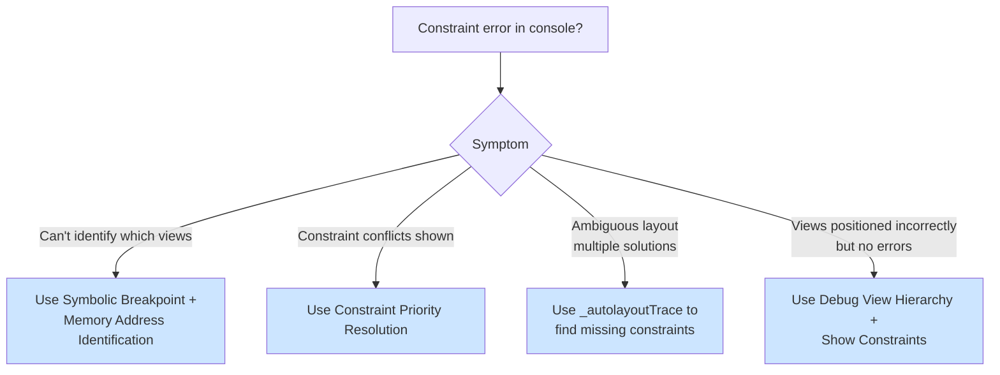

# Auto Layout Debugging

A systematic workflow for Auto Layout constraint errors in UIKit apps. It covers constraint conflicts, ambiguous layouts, and views that end up in the wrong place.

## When to Use

Use this skill when:
- The console shows "Unable to simultaneously satisfy constraints"
- Views are positioned incorrectly or don't appear
- Constraint warnings appear during app launch or navigation
- You see ambiguous layout errors
- Views appear at unexpected sizes
- Debug View Hierarchy shows misaligned views
- Storyboard or XIB constraints behave differently at runtime

**Time savings** Debugging constraints without a workflow typically takes 30–60 minutes; with this one, 5–10 minutes.

## Example Prompts

Questions you can ask your assistant that will draw from this skill:

- "I'm getting 'Unable to simultaneously satisfy constraints' but I can't figure out which view."
- "How do I set up a breakpoint to catch constraint conflicts?"
- "My view appears at the wrong size even though I set width and height constraints."
- "What does 'UIView-Encapsulated-Layout-Height' mean in the error?"
- "How do I use lldb to debug Auto Layout issues?"
- "My cell is showing constraint errors but I can't identify which constraints conflict."

## What This Skill Provides

### Understanding Error Messages
- The anatomy of a constraint conflict message
- Memory addresses that identify views and constraints
- System-generated constraints (`UIView-Encapsulated-Layout-Width` and `-Height`)
- Autoresizing mask constraints (`h=--&`, `v=&--`)

### Debugging Workflow
- A symbolic breakpoint on `UIViewAlertForUnsatisfiableConstraints`
- lldb techniques to identify views from memory addresses: `po $arg1`, a temporary background color, `_autolayoutTrace`, and `constraintsAffectingLayoutForAxis:`
- Debug View Hierarchy with constraint inspection
- Naming constraints and views so future error messages are readable

### Common Conflict Patterns
- Conflicting fixed widths (over-constrained axes)
- `UIView-Encapsulated-Layout` conflicts in table and collection view cells
- Autoresizing mask conflicts from a missing `translatesAutoresizingMaskIntoConstraints = false`
- Ambiguous layouts from missing constraints
- Priority conflicts

### Resolution Strategies
- Constraint priorities: required (1000), `.defaultHigh` (750), or any custom value from 1 to 999
- Removing redundant constraints (two constraints per axis)
- Content hugging and compression resistance
- Fixing ambiguous layouts

## Key Pattern

### Decision Tree



### Symbolic Breakpoint Setup (One Time)

1. Open the Breakpoint navigator (⌘8)
2. Click `+` → "Symbolic Breakpoint"
3. **Symbol**: `UIViewAlertForUnsatisfiableConstraints`
4. (Optional) Add an action → "Sound"
5. Run the app; the breakpoint fires at the moment of the conflict

### Identifying Views from a Memory Address

When the breakpoint fires, print every conflicting constraint and view, then color a suspect view to find it on screen:

```text
(lldb) po $arg1
(lldb) expr ((UIView *)0x7f8b9c4...).backgroundColor = [UIColor redColor]
(lldb) continue
```

### Removing an Over-Constraint

```swift
// ❌ Conflict: width + leading + trailing is three horizontal constraints
imageView.widthAnchor.constraint(equalToConstant: 300).isActive = true
imageView.leadingAnchor.constraint(equalTo: view.leadingAnchor, constant: 20).isActive = true
imageView.trailingAnchor.constraint(equalTo: view.trailingAnchor, constant: -20).isActive = true

// ✅ Resolved: a lower-priority width yields to the required edges
let widthConstraint = imageView.widthAnchor.constraint(equalToConstant: 300)
widthConstraint.priority = .defaultHigh  // 750
widthConstraint.isActive = true
// Keep the leading and trailing constraints as they are
```

## Documentation Scope

This page documents the `auto-layout-debugging` skill in the `axiom-uikit` suite. Your assistant uses it when you hit Auto Layout constraint conflicts in a UIKit app.

## Related

- [lldb](/skills/debugging/lldb) – More debugger techniques for inspecting views and state at a breakpoint
- [swiftui-debugging](/skills/ui-design/swiftui-debugging) – SwiftUI view update and layout problems
- [xcode-debugging](/skills/debugging/xcode-debugging) – Environment checks when the problem is Xcode or the build, not your constraints

## Resources

**WWDC**: 2015-219 (Mysteries of Auto Layout), 2018-220 (High Performance Auto Layout)

**Docs**: /uikit/nslayoutconstraint
