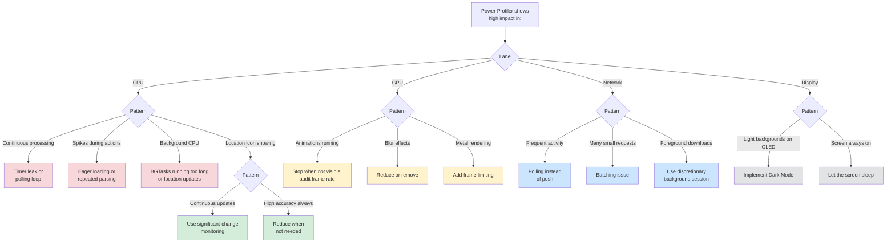

# Energy Optimization

Power Profiler workflows for finding and fixing battery drain. It covers diagnosis for the CPU, GPU, network, location, and display, with a fix for each anti-pattern.

## When to Use

Use this skill when:
- Your app sits at the top of Battery Settings
- The device gets hot during normal use
- Users mention battery drain in reviews
- Xcode's Energy Gauge shows sustained high impact
- Your app runs longer in the background than you expect
- You want to check energy use before a release

**Core principle** Measure before optimizing. Use Power Profiler to find the subsystem that dominates, then apply a targeted fix.

## Example Prompts

Questions you can ask your assistant that will draw from this skill:

- "My app is draining battery faster than expected."
- "Device gets hot when using my app."
- "How do I use Power Profiler to find energy issues?"
- "My app uses too much energy in the background."
- "What's causing high CPU usage?"
- "How do I measure whether my optimization actually improved battery life?"
- "How should my app respond when the system prefers reduced resource usage?" (iOS 27)

## What This Skill Provides

### Power Profiler Workflow
- Recording a five-minute baseline trace over wireless debugging (a charging cable makes the power metrics read zero)
- Finding the dominant lane: CPU, GPU, Display, or Network (location shows up in the CPU lane)
- Verifying the fix with a second recording

### CPU
- Timers without tolerance, and polling that could be event-driven
- Eager loading and repeated parsing
- Background tasks that run too long

### GPU
- Animations that keep running when their view isn't visible
- Blur effects
- Secondary animations at higher frame rates than they need (`CADisplayLink`)
- Metal rendering without frame limiting

### Network
- Polling instead of push notifications
- Batching many small requests
- Discretionary background `URLSession` for deferrable downloads
- Deferring cellular work to Wi-Fi

### Location
- Continuous updates compared with significant-change monitoring
- Choosing the accuracy you actually need, and `distanceFilter`
- `CLLocationUpdate` stationary detection (iOS 26+)
- Justifying background location

### Display
- Dark Mode for OLED power savings (up to 70%)
- Darker UI for high-brightness content
- Letting the screen sleep

### Background Execution and System Signals
- The EMRCA principles (Efficient, Minimal, Resilient, Courteous, Adaptive)
- `BGProcessingTask`, and `BGContinuedProcessingTask` for user-initiated work (iOS 26+)
- Responding to Low Power Mode
- Responding to `systemPrefersReducedResourceUsage` in SwiftUI and UIKit (iOS 27)

### Checks and Monitoring
- Audit checklists for timers, network, location, background execution, display and GPU, and disk I/O
- Pressure scenarios, such as "just poll every 5 seconds" and "ship now, optimize later"
- Field monitoring with MetricKit and the Battery Usage pane in Xcode Organizer

## Key Pattern

### Energy Decision Tree

### Quick Power Profiler Workflow

1. Connect your iPhone to Xcode with wireless debugging
2. Choose Product → Profile, pick the Blank template, and add the Power Profiler instrument
3. Record 2–3 minutes of typical use
4. Find the lane (CPU, GPU, Network, or Display) with the highest sustained impact
5. Apply the fix for that subsystem
6. Record again to verify the improvement

## Documentation Scope

This page documents the `energy` skill in the `axiom-performance` suite. Your assistant uses its Power Profiler workflows when you're diagnosing battery drain in your iOS app.

## Related

- [energy-diag](/diagnostic/energy-diag) – Symptom-based decision trees with time-cost analysis
- [energy-ref](/reference/energy-ref) – API reference with complete code examples from WWDC
- [energy-auditor](/agents/energy-auditor) – Scans your code for timer, polling, location, and animation anti-patterns; run it with [`/axiom:audit energy`](/commands/debugging/audit-energy)
- [performance-profiling](/skills/debugging/performance-profiling) – Choosing and using other Instruments templates
- [memory-debugging](/skills/debugging/memory-debugging) – Finding the timer and observer leaks that keep CPU busy

## Resources

**WWDC**: 2025-226, 2025-227, 2022-10083, 2020-10095, 2019-417

**Docs**: /xcode/improving-your-app-s-performance
