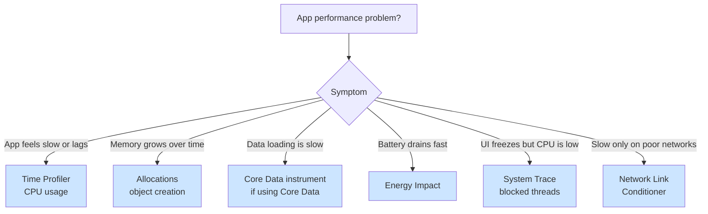

# Performance Profiling

Decision trees for choosing the right Instruments tool and reading its results correctly. It covers Time Profiler, Allocations, Core Data, Energy Impact, custom signposts, and the new tools in Instruments 27.

## When to Use

Use this skill when:
- The app feels slow (UI lags, or loads take 5+ seconds)
- Memory grows over time in Xcode's memory gauge
- The battery drains fast or the device gets hot
- You're unsure which Instruments tool to use
- Profiling results are confusing or contradictory
- You want to profile before users complain

**Core principle** Measure before optimizing. Guessing wastes more time than profiling.

## Example Prompts

Questions you can ask your assistant that will draw from this skill:

- "My app feels slow. Which Instruments tool should I use?"
- "How do I read Time Profiler results? What's the difference between Self Time and Total Time?"
- "Memory keeps growing but I don't see leaks. What's happening?"
- "How do I find N+1 queries with the Core Data instrument?"
- "My app drains battery. How do I profile energy usage?"
- "Time Profiler shows a hot spot but fixing it didn't help. What did I miss?"
- "How do I add custom signposts to measure my own code paths?"
- "How do I set up automated performance regression tests?"
- "No single function is hot but the app still hangs. How do I find scattered overhead?"
- "How do I compare two Instruments runs to verify my fix?"

## What This Skill Provides

### Decision Tree



### Time Profiler Deep Dive
- Self Time compared with Total Time (the critical distinction)
- Call tree navigation and the heaviest stack trace
- Finding hot spots
- Common mistakes: blaming the wrong function, profiling the wrong code path, and not isolating the problem

### Allocations Deep Dive
- Reading the process's peak footprint before recording, to tell a transient spike from steady growth
- Finding memory growth and persistent objects
- Telling growth from a leak, and accounting for caches
- Recording long enough to see the pattern

### Core Data Deep Dive
- N+1 query detection with SQL logging
- Relationship prefetching
- Batching with `fetchBatchSize`, and faulting to reduce memory

### Other Tools
- Energy Impact: CPU, GPU, network, and location usage, and background activity
- Network Link Conditioner for slow-connection testing
- System Trace for main-thread blocking and lock contention
- Command-line checks without Instruments: `sample`, `leaks`, and `xctrace`

### OSSignposter
- Custom performance instrumentation with `beginInterval` and `endInterval`
- The Points of Interest lane in Instruments
- When to use signposts and when to use Time Profiler

### Regression-Proofing Pipeline
- Three stages: OSSignposter (development) → XCTest performance tests (CI) → MetricKit (production)
- All seven `XCTMetric` types (clock, CPU, memory, storage, signpost, launch, hitch)
- Performance baselines and tolerance in Xcode
- Bridging signposts to automated tests with `XCTOSSignpostMetric`

### Instruments 27 and the Xcode 27 Organizer
- Top Functions mode for scattered overhead (dynamic dispatch, retain/release, existentials)
- Run Comparisons: before-and-after deltas across runs in one document
- The Inspector panel, and System Trace analysis of blocked threads (syscalls)
- The Swift executors instrument for main-actor congestion
- The Foundation Models instrument for the latency of agentic and LLM features
- Organizer: a redesigned Overview, storage and hitch metrics, Metric Goals, and agentic Generate Recommendations

### Pressure Scenarios
- "Profile shows function X is 80% CPU"
- "Memory is 500MB, that's a leak!"
- "Core Data queries are slow, redesign the schema!"
- Results that differ between runs, and Time Profiler and Allocations pointing at different problems
- Profiling under deadline pressure

## Key Pattern

### Self Time vs Total Time

```
Self Time: Time spent IN this function (not callees)
Total Time: Time spent in this function AND all callees

Example reading:
┌─────────────────────────────┬──────────┬────────────┐
│ Function                    │ Self Time│ Total Time │
├─────────────────────────────┼──────────┼────────────┤
│ processData()               │ 2ms      │ 500ms      │ ← NOT the problem
│   └─ expensiveSort()        │ 498ms    │ 498ms      │ ← THE problem
└─────────────────────────────┴──────────┴────────────┘

✅ Look at Self Time to find actual bottleneck
❌ Don't optimize processData() based on Total Time alone
```

### Quick Profiling Workflow

1. **Profile on a real device**, not the simulator
2. **Record the specific interaction** that's slow, not just app launch
3. **Look at Self Time** first
4. **Fix the function with the most Self Time**
5. **Measure after the fix** to verify the improvement

## Documentation Scope

This page documents the `performance-profiling` skill in the `axiom-performance` suite. Your assistant uses its Instruments decision trees, tool walkthroughs, real-world examples, and pressure scenarios when helping you profile performance problems.

## Related

- [swiftui-performance](/skills/ui-design/swiftui-performance) – The SwiftUI instrument and view update analysis
- [memory-debugging](/skills/debugging/memory-debugging) – Retain cycle and leak diagnosis
- [trace-comparison](/skills/debugging/trace-comparison) – Command-line before-and-after comparison and CI gating with `xcprof compare`
- [xcode-debugging](/skills/debugging/xcode-debugging) – Environment-first diagnostics before profiling
- [swift-concurrency](/skills/concurrency/swift-concurrency) – Moving CPU work off the main thread
- [swift-performance](/skills/concurrency/swift-performance) – Language-level optimization once you've found the bottleneck
- [metrickit-ref](/reference/metrickit-ref) – Monitoring performance in production, the last stage of the regression pipeline

## Resources

**WWDC**: 2023-10160, 2024-10217, 2025-308, 2025-312, 2026-258, 2026-268, 2026-243

**Docs**: /library/archive/technotes/tn2224, /os/ossignposter, /xctest/xctestcase/measure, /xcode/analyzing-cpu-profiles-with-call-tree-views, /xcode/improving-your-app-s-performance
