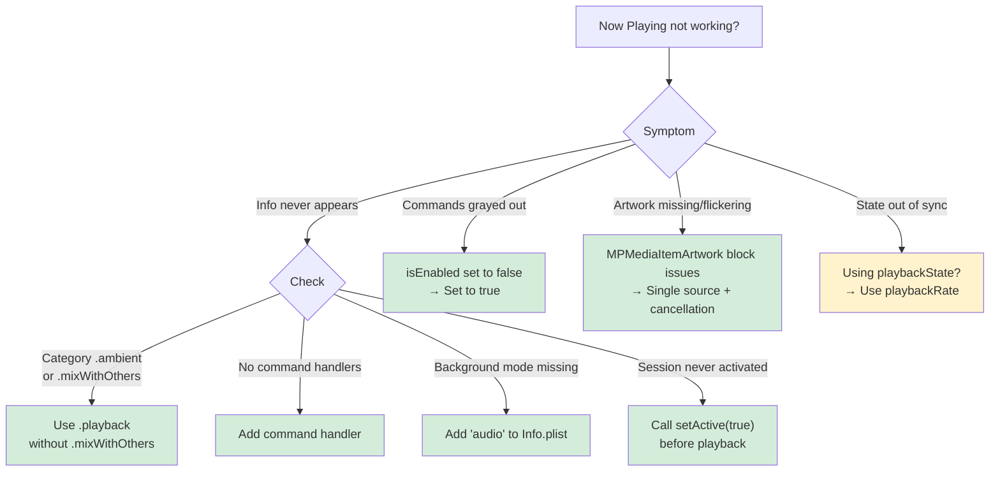

# Now Playing Integration

Puts your audio or video app's playback on the Lock Screen and in Control Center, using either the MediaPlayer APIs (`MPNowPlayingInfoCenter`, and `MPNowPlayingSession` from iOS 16) or the Swift-native NowPlaying framework introduced in iOS 27. Also covers CarPlay, MusicKit, Siri, and animated Lock Screen artwork.

## When to Use

Use this skill when:
- Now Playing info doesn't appear on the Lock Screen or in Control Center
- Play, pause, or skip buttons are grayed out or don't respond
- Album artwork is missing, wrong, or flickers between images
- Animated Lock Screen artwork (iOS 26+) doesn't appear
- Control Center shows "Playing" when your app is paused, or vice versa
- Another app "steals" Now Playing status from your app
- You're implementing Now Playing for the first time
- You're adding Now Playing to a CarPlay audio app
- You're showing playback from a speaker, TV, or other device your app controls (iOS 27)
- You want Siri's "pause", "next", or "what song is this?" to work with your app

**Core insight** With the MediaPlayer APIs, Now Playing needs three things: an active `AVAudioSession`, remote command handlers, and published metadata. Leave out any one and your app silently never appears.

## Example Prompts

Questions you can ask your assistant that will draw from this skill:

- "Why does Now Playing info appear when playback starts, then disappear when I lock the screen?"
- "Why are the play and pause buttons in Control Center grayed out?"
- "Why does my album artwork flicker between images when the track changes?"
- "Control Center shows 'Playing' when my app is paused. How do I keep them in sync?"
- "Why does Apple Music take over Now Playing from my app?"
- "How do I add Now Playing support to my CarPlay audio app?"
- "How do I adopt the new NowPlaying framework on iOS 27?"
- "Why doesn't `requestToBecomeSystemPrimary()` put my session on the Lock Screen?"
- "How do I show playback from our smart speaker on the Lock Screen when our app isn't running?"

## What This Skill Provides

### AVAudioSession Configuration (Pattern 1)
- Non-mixable `.playback` category for eligibility
- The `audio` background mode in Info.plist
- Activating the session before playback starts
- Deactivating with `.notifyOthersOnDeactivation`

### Remote Command Registration (Pattern 2)
- Command targets (registering a target enables the command by default)
- Skip intervals with `preferredIntervals`
- Handler return values
- Keeping strong references to targets, which `MPRemoteCommandCenter` doesn't retain

### Artwork (Pattern 3)
- `MPMediaItemArtwork` with a size handler that returns the image closest to the requested size
- Marking that handler `@Sendable` and capturing the image, because the system calls it off the main thread and Swift 6 otherwise crashes there
- A single source of truth to prevent flickering
- Cancelling the previous artwork load on track change

### Playback State Sync (Pattern 4)
- `playbackRate`, not `playbackState`, on iOS
- When to update: play, pause, seek, and track change
- Never on a timer, which causes jitter
- Preserving existing dictionary values on partial updates

### MPNowPlayingSession (Pattern 5)
- Automatic publishing from iOS 16
- Using `session.remoteCommandCenter`, not `MPRemoteCommandCenter.shared()`
- `becomeActiveIfPossible()` for eligibility
- Multiple sessions for Picture in Picture

### CarPlay (Pattern 6)
- The same `MPNowPlayingInfoCenter` as iOS
- The `com.apple.developer.carplay-audio` entitlement
- Custom buttons via `CPNowPlayingTemplate`
- Configuration at scene connection

### MusicKit (Pattern 7)
- `ApplicationMusicPlayer` publishes Now Playing info automatically
- Don't set `nowPlayingInfo` yourself for Apple Music content
- Hybrid apps that switch between players

### Animated Artwork (Pattern 8, iOS 26+)
- `MPMediaItemAnimatedArtwork` for full-screen Lock Screen video
- Capability gating via `MPNowPlayingInfoCenter.supportedAnimatedArtworkKeys`
- Separate 1:1 (square) and 3:4 (tall) aspect-ratio keys
- Video assets must be local file URLs
- An album-stable `artworkID` to prevent re-downloads
- Always paired with static `MPMediaItemPropertyArtwork`, for iOS 18 and as the system fallback

### NowPlaying Framework (iOS 27+)
- `import NowPlaying` – The Swift-native alternative to the MediaPlayer dictionary and command APIs
- Your `@Observable` model conforms to `MediaSessionRepresentable`, and the system observes it, so there are no manual refreshes
- Strongly typed content (`MusicContent`, `PodcastContent`, `MovieContent`, …) instead of a string-keyed dictionary, with a guide to which type fits which media and what each initializer fills in for you
- A declarative `[MediaCommand]` array with `async` closures instead of per-command `MPRemoteCommandCenter` targets, and what each command passes your closure, such as the skip interval the listener chose
- Playback snapshots that pair the elapsed time with a timestamp, so the system can advance the progress bar on its own between updates, and when a snapshot needs only the playback state
- The session life cycle: configuring the audio session first, running more than one session, removing a session, and the rule that `requestToBecomeSystemPrimary()` only works while your app is in the foreground
- Playback on other devices (iPhone and iPad only): remote sessions, backed by a `RemoteMediaSessionExtension` app extension, that your server can start, update, and end with push notifications while your app isn't running
- A known issue in iOS 27: remote-session push tokens always target the production APNs environment, so test pushes must go through production
- The MediaPlayer APIs aren't deprecated, so Patterns 1–8 still apply to apps that support versions before iOS 27
- Use one API or the other for playback on the device, never both: Apple says mixing the NowPlaying framework with `MPNowPlayingInfoCenter` and `MPRemoteCommandCenter` results in undefined behavior

### Siri
- Siri's "pause", "next", and "what song is this?" use the same commands and metadata as the Lock Screen
- Entity annotations (iOS 27) that tell Siri which song or artist is playing, so requests like "add this to my playlist" resolve against your catalog

## Key Pattern

### The MediaPlayer Eligibility Requirements

```swift
// ✅ All three required for Now Playing to appear:

// 1. Non-mixable audio session
try AVAudioSession.sharedInstance().setCategory(.playback, options: [])
try AVAudioSession.sharedInstance().setActive(true)

// 2. At least one command handler
let commandCenter = MPRemoteCommandCenter.shared()
commandCenter.playCommand.addTarget { _ in .success }

// 3. Metadata published
MPNowPlayingInfoCenter.default().nowPlayingInfo = [
    MPMediaItemPropertyTitle: "Track Name",
    MPNowPlayingInfoPropertyPlaybackRate: 1.0  // iOS uses rate, not playbackState
]
```

### Decision Tree



## Documentation Scope

This page documents the `now-playing` skill (in the `axiom-media` suite), which your assistant uses when you implement or debug Lock Screen and Control Center integration for an audio or video app.

## Related

- [now-playing-carplay](/reference/now-playing-carplay) – CarPlay Now Playing details: `CPNowPlayingTemplate` buttons, entitlement setup, and CarPlay-specific debugging
- [now-playing-musickit](/reference/now-playing-musickit) – `ApplicationMusicPlayer` publishing and hybrid apps that mix Apple Music with your own content
- [siri-audio](/skills/integration/siri-audio) – "Play X in MyApp" and other Siri requests that start playback, which go through App Intents rather than Now Playing commands
- [system-media-routing](/skills/integration/system-media-routing) – Media Sharing Extensions: playing to non-AirPlay speakers and TVs through the system device picker, the third topic of the NowPlaying WWDC session
- [avfoundation-ref](/reference/avfoundation-ref) – `AVAudioSession` configuration in depth, plus spatial audio formats
- [memory-debugging](/skills/debugging/memory-debugging) – Retain cycle diagnosis in closure-based command handlers
- [swift-concurrency](/skills/concurrency/swift-concurrency) – `@MainActor` patterns for async artwork loading

## Resources

**WWDC**: 2017-251, 2019-501, 2022-110338, 2026-312

**Docs**: /nowplaying, /nowplaying/publishing-media-sessions, /nowplaying/publishing-remote-media-sessions, /nowplaying/content-types-and-metadata, /nowplaying/playback-commands, /mediaplayer/mpnowplayinginfocenter, /mediaplayer/mpnowplayingsession, /mediaplayer/mpremotecommandcenter, /mediaplayer/mpmediaitemanimatedartwork, /mediaplayer/providing-animated-artwork-for-media-items
