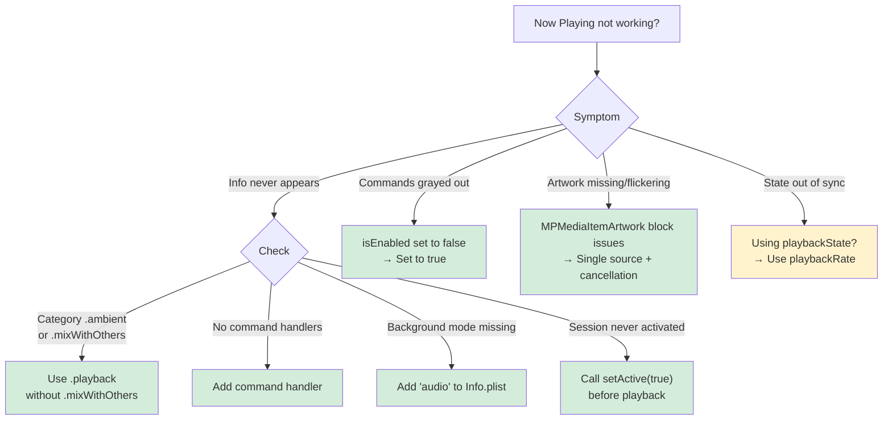

# Now Playing Integration

Lock Screen and Control Center integration for audio and video apps, from the MediaPlayer APIs (`MPNowPlayingInfoCenter`, and `MPNowPlayingSession` from iOS 16) to the Swift-native NowPlaying framework in iOS 27. Also covers CarPlay, MusicKit, and animated Lock Screen artwork.

## When to Use

Use this skill when:
- Now Playing info doesn't appear on the Lock Screen or in Control Center
- Play, pause, or skip buttons are grayed out or don't respond
- Album artwork is missing, wrong, or flickers between images
- Animated Lock Screen artwork (iOS 26+) doesn't appear
- Control Center shows "Playing" when your app is paused, or vice versa
- Another app "steals" Now Playing status from your app
- You're implementing Now Playing for the first time
- You're adding Now Playing to a CarPlay audio app

**Core insight** Now Playing eligibility requires three things: an active `AVAudioSession`, remote command handlers, and published metadata. Missing any one of them silently breaks the whole system.

## Example Prompts

Questions you can ask your assistant that will draw from this skill:

- "Now Playing info shows briefly when playback starts, then disappears when I lock the screen."
- "Play/pause buttons in Control Center are grayed out or don't respond to taps."
- "Album artwork never appears, or shows wrong artwork, or flickers between images."
- "Control Center shows 'Playing' when my app is actually paused. How do I sync them?"
- "Apple Music takes over and my app loses Now Playing control."
- "How do I add Now Playing support to my CarPlay audio app?"
- "How do I adopt the new NowPlaying framework / MediaSession on iOS 27?"

## What This Skill Provides

### AVAudioSession Configuration (Pattern 1)
- Non-mixable `.playback` category for eligibility
- The `audio` background mode in Info.plist
- Activating the session before playback starts
- Deactivating with `.notifyOthersOnDeactivation`

### Remote Command Registration (Pattern 2)
- Command targets (registering a target enables the command by default)
- Skip intervals with `preferredIntervals`
- Handler return values
- Keeping strong references to targets, which `MPRemoteCommandCenter` doesn't retain

### Artwork (Pattern 3)
- `MPMediaItemArtwork` with a size handler that returns the image closest to the requested size
- A single source of truth to prevent flickering
- Cancelling the previous artwork load on track change

### Playback State Sync (Pattern 4)
- `playbackRate`, not `playbackState`, on iOS
- When to update: play, pause, seek, and track change
- Never on a timer, which causes jitter
- Preserving existing dictionary values on partial updates

### MPNowPlayingSession (Pattern 5)
- Automatic publishing from iOS 16
- Using `session.remoteCommandCenter`, not `MPRemoteCommandCenter.shared()`
- `becomeActiveIfPossible()` for eligibility
- Multiple sessions for Picture in Picture

### CarPlay (Pattern 6)
- The same `MPNowPlayingInfoCenter` as iOS
- The `com.apple.developer.carplay-audio` entitlement
- Custom buttons via `CPNowPlayingTemplate`
- Configuration at scene connection

### MusicKit (Pattern 7)
- `ApplicationMusicPlayer` publishes Now Playing info automatically
- Don't set `nowPlayingInfo` yourself for Apple Music content
- Hybrid apps that switch between players

### Animated Artwork (Pattern 8, iOS 26+)
- `MPMediaItemAnimatedArtwork` for full-screen Lock Screen video
- Capability gating via `MPNowPlayingInfoCenter.supportedAnimatedArtworkKeys`
- Separate 1:1 (square) and 3:4 (tall) aspect-ratio keys
- Video assets must be local file URLs
- An album-stable `artworkID` to prevent re-downloads
- Always paired with static `MPMediaItemPropertyArtwork`, for iOS 18 and as the system fallback

### NowPlaying Framework (iOS 27+)
- `import NowPlaying` – The Swift-native successor to the MediaPlayer dictionary and command APIs
- Your `@Observable` model conforms to `MediaSessionRepresentable`, and the system observes it, so there are no manual refreshes
- Strongly typed content (`MusicContent`, `PodcastContent`, `MovieContent`, …) instead of a string-keyed dictionary
- A declarative `[MediaCommand]` array with `async` closures instead of per-command `MPRemoteCommandCenter` targets
- Remote and server-driven playback via a push-based `RemoteMediaSession` extension (iOS only)
- Doesn't deprecate the MediaPlayer APIs, so Patterns 1–8 remain valid for apps that support versions before iOS 27

## Key Pattern

### The Eligibility Requirements

```swift
// ✅ All three required for Now Playing to appear:

// 1. Non-mixable audio session
try AVAudioSession.sharedInstance().setCategory(.playback, options: [])
try AVAudioSession.sharedInstance().setActive(true)

// 2. At least one command handler
let commandCenter = MPRemoteCommandCenter.shared()
commandCenter.playCommand.addTarget { _ in .success }

// 3. Metadata published
MPNowPlayingInfoCenter.default().nowPlayingInfo = [
    MPMediaItemPropertyTitle: "Track Name",
    MPNowPlayingInfoPropertyPlaybackRate: 1.0  // iOS uses rate, not playbackState
]
```

### Decision Tree



## Documentation Scope

This page documents the `now-playing` skill (in the `axiom-media` suite), which your assistant uses when you implement or debug Lock Screen and Control Center integration for an audio or video app.

## Related

- [now-playing-carplay](/reference/now-playing-carplay) – CarPlay Now Playing details: `CPNowPlayingTemplate` buttons, entitlement setup, and CarPlay-specific debugging
- [now-playing-musickit](/reference/now-playing-musickit) – `ApplicationMusicPlayer` publishing and hybrid apps that mix Apple Music with your own content
- [avfoundation-ref](/reference/avfoundation-ref) – AVAudioSession configuration, spatial audio, ASAF/APAC
- [memory-debugging](/skills/debugging/memory-debugging) – Retain cycle diagnosis in closure-based command handlers
- [swift-concurrency](/skills/concurrency/swift-concurrency) – `@MainActor` patterns for async artwork loading

## Resources

**WWDC**: 2017-251, 2019-501, 2022-110338, 2026-312

**Docs**: /nowplaying, /mediaplayer/mpnowplayinginfocenter, /mediaplayer/mpnowplayingsession, /mediaplayer/mpremotecommandcenter, /mediaplayer/mpmediaitemanimatedartwork
