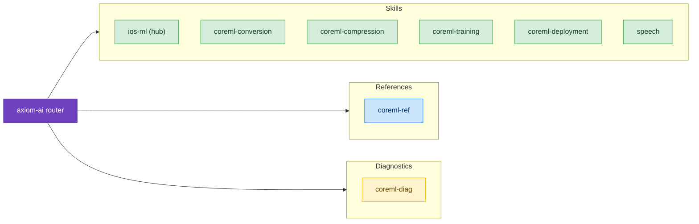

# Machine Learning

Skills for deploying and running machine learning models on Apple devices using CoreML and related frameworks.

## Available Skills

### [iOS ML](/skills/machine-learning/ios-ml)

The hub for on-device machine learning and speech-to-text. It routes your question to the right skill for each stage of a Core ML model's life, to Core AI for language-model-scale models, or to speech.

### [Core ML Conversion](/skills/machine-learning/coreml-conversion)

Convert a trained PyTorch, TensorFlow, or Keras model with `coremltools`, choose a deployment target, convert stateful models, and check that the converted model matches the original.

### [Core ML Compression](/skills/machine-learning/coreml-compression)

Shrink a model with quantization, palettization, or pruning, decide between post-training and training-time compression, and re-measure accuracy at each step.

### [Core ML Training](/skills/machine-learning/coreml-training)

Train a new model with Create ML, or personalize a deployed model on the user's device with `MLUpdateTask`, and know its format limitation before you build.

### [Core ML Deployment](/skills/machine-learning/coreml)

Run a converted model in your app: loading and pre-warming, compute units, Swift 6-safe prediction, stateful KV-cache models, multifunction adapters, and `MLTensor` pipelines.

### [ML Training Paths](/skills/machine-learning/training-paths)

Pick the right training toolchain before you build — disambiguates Foundation Models adapters, Create ML, `MLUpdateTask` personalization, coremltools conversion, and MLX, and flags the format and toolchain traps that make a trained artifact fail to load.

### [Core AI](/skills/machine-learning/core-ai)

Core AI (iOS 27) — the on-device inference framework behind Apple Intelligence, now open to apps. Convert PyTorch models to `.aimodel`, run them from Swift across CPU, GPU, and Neural Engine, and back a `LanguageModelSession` with your own model.

### [Speech](/skills/machine-learning/speech)

On-device speech-to-text with `SpeechAnalyzer` (iOS 26 and later): file and live transcription, model assets, the limit on simultaneous analyses, and the iOS 27 audio input providers.

## Available References

- [Core ML Reference](/reference/coreml-ref) – `MLModel`, configuration, compute devices, prediction and Sendability, `MLState`, `MLTensor`, `MLComputePlan`, and the `coremltools` index

## Available Diagnostics

- [Core ML Diagnostics](/diagnostic/coreml-diag) – Load errors, slow first load or predictions, memory growth, device and Simulator differences, and accuracy loss after compression

## Example Prompts

- "How do I convert a PyTorch model to CoreML?"
- "My CoreML model is too large, how do I compress it?"
- "How do I implement speech-to-text with SpeechAnalyzer?"
- "Model inference is slow, how do I optimize it?"
