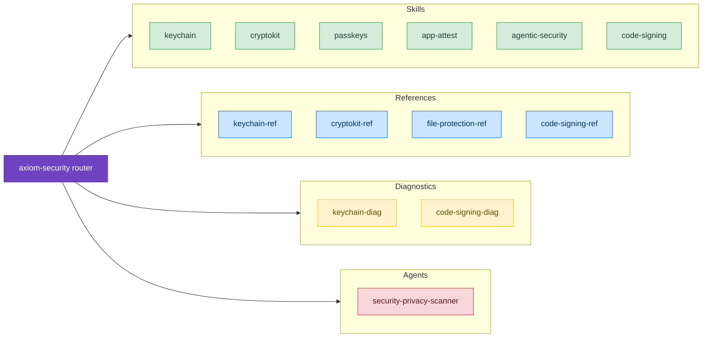

# Security

Store credentials safely, encrypt with modern algorithms, sign users in without passwords, prove requests come from your genuine app, keep AI features safe from prompt injection, and sign your builds. These skills cover Keychain Services, CryptoKit, passkeys, App Attest, agentic-feature security, and code signing, plus the everyday choices around them: the right `kSecAttrAccessible` level, the right algorithm family, and the right server-side validation.

## When to Use These Skills

Use security skills when you're:

- Storing passwords, tokens, refresh tokens, or any credential that must survive app updates and device migrations
- Encrypting data at rest, signing payloads, or generating keys in the Secure Enclave
- Adding passkey sign-in, or moving an existing password-based account to passkeys
- Verifying that requests to your server come from an unmodified copy of your app
- Protecting an AI agent or App Intent from prompt injection
- Setting up code signing, certificates, and provisioning profiles
- Debugging `errSecDuplicateItem`, `errSecItemNotFound`, or `ASAuthorization*` errors
- Choosing the right `kSecAttrAccessible` level for a credential, or the right algorithm family for a use case
- Adopting post-quantum cryptography (ML-KEM, ML-DSA) for data that must stay secret for a decade or more

## Example Prompts

Questions you can ask your assistant that will draw from these skills:

- "How do I store an OAuth refresh token so it survives device restore from iCloud backup?"
- "I'm getting `errSecDuplicateItem` on every update. What's the right SecItem pattern?"
- "Should I use AES-GCM or ChaChaPoly for encrypting local files?"
- "How do I generate an ECDSA key in the Secure Enclave and use it to sign API requests?"
- "What's the migration path from password sign-in to passkeys without forcing users to re-enroll?"
- "My passkeys don't show up in the QuickType bar. What am I missing?"
- "How do I roll out App Attest without breaking users on devices that don't support it?"
- "I need biometric protection on my keychain item. Does Face ID happen before or after `SecItemCopyMatching`?"

## Skills

- **[Keychain](/skills/security/keychain)** – Secure credential storage with SecItem APIs, accessibility levels, access groups, biometric protection
  - *"How do I store a token so the app extension can read it but other apps can't?"*
  - *"Why does my keychain item disappear after the user restores from backup?"*

- **[CryptoKit](/skills/security/cryptokit)** – Symmetric and asymmetric crypto, hashing, Secure Enclave keys, HPKE, post-quantum algorithms
  - *"AES-GCM or ChaChaPoly — which one for at-rest file encryption?"*
  - *"How do I migrate my CommonCrypto AES code to CryptoKit?"*

- **[Passkeys](/skills/security/passkeys)** – Registration and assertion flows, AutoFill-assisted requests, password-to-passkey upgrades, cross-device sign-in
  - *"What's the right `ASAuthorizationPlatformPublicKeyCredentialProvider` flow for sign-up?"*
  - *"How do I support passkeys and keep a password fallback during migration?"*

- **[App Attest](/skills/security/app-attest)** – DeviceCheck framework, server-side attestation validation, assertion lifecycle, fraud metric
  - *"How do I validate the attestation object on my server?"*
  - *"`isSupported` returns false. Should I block the user?"*

- **[Agentic Security](/skills/security/agentic-security)** – Prompt-injection threat modeling and action gating for Foundation Models agents and App Intents
  - *"How do I protect my app's AI agent from prompt injection?"*
  - *"Should my App Intent run from the lock screen?"*

- **[Code Signing](/skills/debugging/code-signing)** – Certificates, provisioning profiles, entitlements, and CI/CD signing
  - *"Should I use automatic or manual signing?"*
  - *"How do I set up fastlane match for my team?"*

## References, Diagnostics, and Agents

- [keychain-ref](/reference/keychain-ref) – SecItem function signatures, attribute constants, and accessibility levels
- [keychain-diag](/diagnostic/keychain-diag) – specific `errSec` error codes and lost-item scenarios
- [cryptokit-ref](/reference/cryptokit-ref) – every CryptoKit algorithm family, type, and API detail
- [file-protection-ref](/reference/file-protection-ref) – Data Protection classes for files stored outside the keychain
- [code-signing-ref](/reference/code-signing-ref) – signing CLI commands, profile inspection, and entitlement extraction
- [code-signing-diag](/diagnostic/code-signing-diag) – certificate, profile, and entitlement errors
- [security-privacy-scanner](/agents/security-privacy-scanner) – an agent that scans your project for hardcoded credentials, insecure storage, and privacy manifest gaps

## Related

- [Shipping](/skills/shipping/) – App Store submission, including privacy manifests and the export-compliance answers an app that uses encryption must give
- [privacy-ux](/skills/integration/privacy-ux) – privacy UX, permission prompts, and privacy manifests; pair it with this suite whenever you handle sensitive data
- [sandbox-and-file-access](/skills/macos/sandbox-and-file-access) – the App Sandbox and security-scoped bookmarks; pair it with keychain access groups in sandboxed Mac apps
- [networking](/skills/integration/networking) – URLSession authentication challenges and TLS pinning; CryptoKit handles client-side request signing
- [Persistence](/skills/persistence/) – SwiftData, Core Data, and GRDB; this suite applies when you persist credentials or encrypted data
