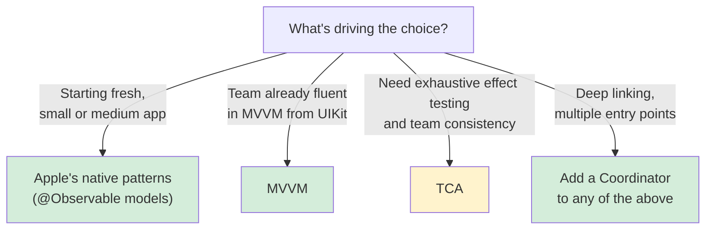
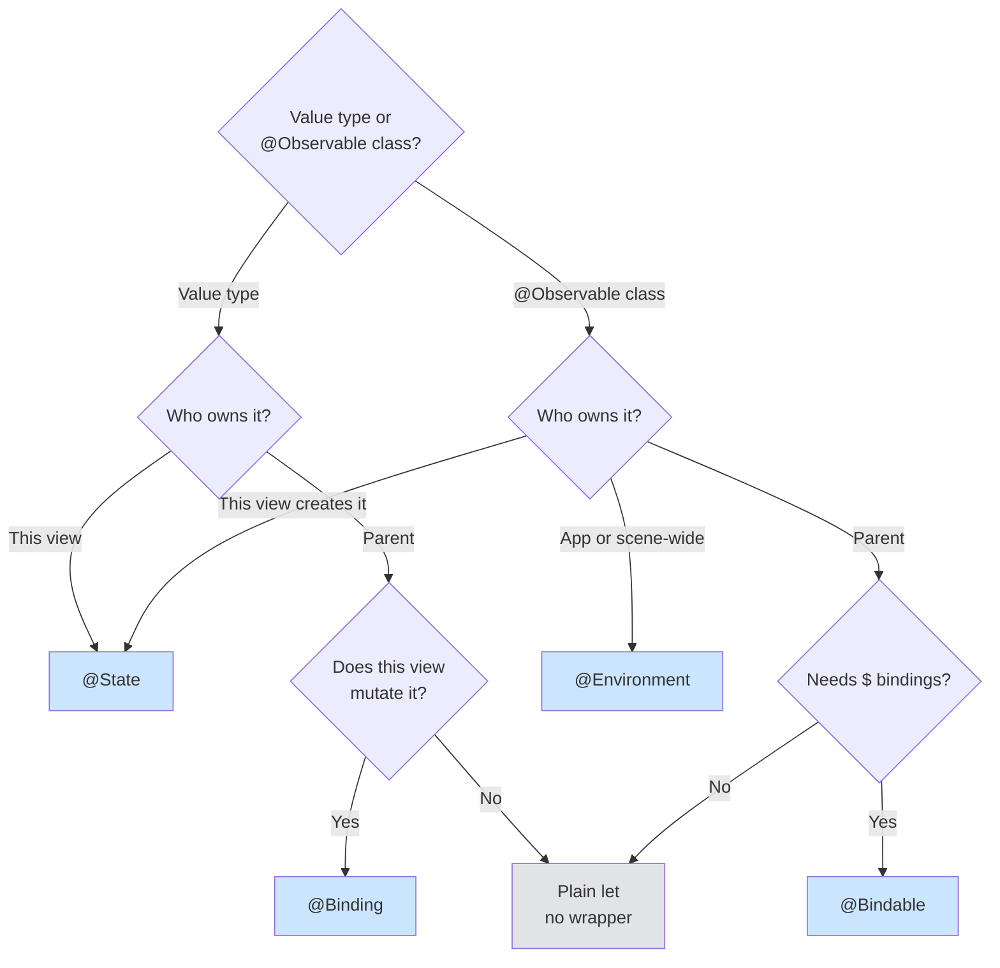

# SwiftUI Architecture

Where code belongs in a SwiftUI app. Covers Apple's native patterns (`@Observable` models and the state-as-bridge pattern), MVVM, TCA, and coordinators, with decision trees for choosing between them.

## When to Use

Use this skill when you're:
- Extracting logic from SwiftUI view files
- Choosing between MVVM, TCA, Apple's native patterns, or coordinators
- Refactoring views to separate concerns
- Making SwiftUI code testable
- Asking "where should this code go?"
- Deciding which property wrapper to use (`@State`, `@Binding`, `@Environment`, `@Bindable`)
- Fixing `@State` code that broke when you moved to Xcode 27

## Example Prompts

Questions you can ask your assistant that will draw from this skill:

- "There's quite a bit of code in my view files about logic things. How do I extract it?"
- "Should I use MVVM, TCA, or Apple's vanilla patterns?"
- "How do I make my SwiftUI code testable?"
- "Where should formatters and calculations go?"
- "Which property wrapper do I use?"
- "My `@State` property stopped compiling after upgrading to Xcode 27."
- "Why is my `@State` model being recreated every time the view is rebuilt?"
- "I set my `@State` value in `init` but the view shows the old one."

## What This Skill Provides

### Apple's Native Patterns
- `@Observable` models in place of `ObservableObject`
- The state-as-bridge pattern for async work: synchronous state changes drive animation, and async code lives in a `@MainActor` model
- Bridging state owned by a custom actor to SwiftUI through an `@Observable` proxy, and `Observations` for the reverse direction
- `.task` lifecycle: it cancels when the view is destroyed or its identity changes, not when the body re-evaluates, plus the `.task(id:)` pitfalls
- **`@State` is a macro** (Xcode 27) – the initial value is evaluated at most once instead of on every view init, but only for `private` or `fileprivate` declarations with a deployment target of iOS 17 or later
- The three source-compatibility breaks Apple documents in technote TN3211, plus one that compiles and is still wrong: an inline initial value paired with an `init` assignment silently discards the `init` value

### Property Wrappers
- A decision tree that asks two questions: is it a value type or an `@Observable` class, and who owns it
- Why `@Bindable` doesn't compile on a value type, and why a parent-owned `@Observable` needs no wrapper at all

### MVVM
- What a ViewModel costs in SwiftUI before you add one
- When MVVM adds value, such as complex presentation logic or a team migrating from UIKit
- Common mistakes: owning a model the parent owns, the god ViewModel, and business logic in the ViewModel

### TCA (The Composable Architecture)
- When the third-party TCA library is worth its boilerplate and learning curve
- Its core concepts and trade-offs, and when to choose it over Apple's patterns

### Coordinators
- When coordinators help (complex navigation, deep links, multiple entry points)
- A minimal coordinator whose routes carry IDs, not models
- Combining a coordinator with any of the architectures above

### Refactoring, Anti-Patterns, and Review
- A four-step workflow for moving logic out of views and verifying it's testable
- Seven anti-patterns with before-and-after code, including logic in the view body, the wrong property wrapper, `@AppStorage` inside an `@Observable` class, and circular state in `@ViewBuilder` closures
- A code review checklist and pressure scenarios for pushing back

## Key Patterns

### State-as-Bridge Pattern

```swift
// UI state changes stay synchronous (for animations)
// Async code lives in the model (testable without SwiftUI)
// State bridges the two

@MainActor  // Required: without it, passing the model fails under Swift 6
@Observable
final class ColorExtractor {
    var isLoading = false
    var colors: [Color] = []

    func extract(from image: UIImage) async {
        colors = await heavyComputation(image)
    }
}

struct ColorExtractorView: View {
    let extractor: ColorExtractor

    var body: some View {
        Button("Extract Colors") {
            withAnimation { extractor.isLoading = true }

            Task {
                await extractor.extract(from: currentImage)
                withAnimation { extractor.isLoading = false }
            }
        }
        .scaleEffect(extractor.isLoading ? 1.5 : 1.0)
    }
}
```

### Architecture Decision Tree



### Property Wrapper Decision Tree



## Documentation Scope

This page documents the `architecture` skill (in the `axiom-swiftui` suite), which your assistant draws on when you organize SwiftUI code, extract logic from views, or choose an architecture.

- For automated scanning, use [swiftui-architecture-auditor](/agents/swiftui-architecture-auditor), or run [/axiom:audit-swiftui-architecture](/commands/ui-design/audit-swiftui-architecture)

## Related

- [swiftui-nav](/skills/ui-design/swiftui-nav) – Navigation patterns, including the coordinator structure, URL deep links, and state restoration
- [app-composition](/skills/ui-design/app-composition) – App-level patterns (`@main`, root view switching) above the feature level
- [swiftui-debugging](/skills/ui-design/swiftui-debugging) – Diagnosing views that don't update, including the circular-state case
- [swift-concurrency](/skills/concurrency/swift-concurrency) – Async patterns for models, and `.defaultIsolation(MainActor.self)` for a whole target

## Resources

**WWDC**: 2023-10149, 2023-10160, 2024-10150, 2025-266

**Docs**: /swiftui/managing-model-data-in-your-app, /observation/observations, /technotes/tn3211
