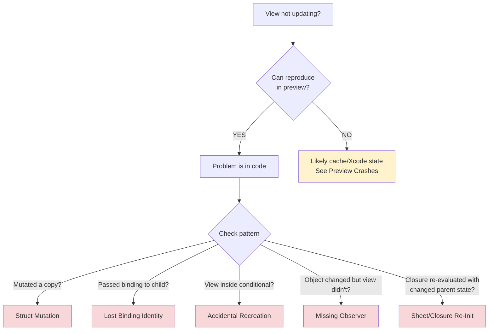

# SwiftUI Debugging

Diagnostic decision trees for SwiftUI views that don't update, previews that crash, layout problems, and view identity. The skill works through each symptom systematically so you stop guessing under pressure.

## When to Use

Use this skill when:
- A view isn't updating when you expect it to
- A preview crashes or won't load
- Layout looks wrong on specific devices or screen sizes
- State resets unexpectedly when you navigate or toggle a condition
- You're tempted to add `@ObservedObject` everywhere as a band-aid

**Core principle:** Start with observable symptoms, test systematically, and eliminate causes one by one. Don't guess.

## Example Prompts

Questions you can ask your assistant that will draw from this skill:

- "My list item doesn't update when I tap the favorite button, even though the data changed."
- "Preview crashes with 'No ObservableObject of type AppModel found' but the app runs fine."
- "My counter resets to 0 every time I toggle a boolean. Why?"
- "I'm using `@Observable` but the view still doesn't update when I change the property."
- "My text field loses focus when I start typing."
- "My sheet always skips its loading animation and shows the completed state."
- "Layout looks wrong on iPad but fine on iPhone."

## What This Skill Provides

### View Not Updating Decision Tree
- **Struct mutation** – mutating a local copy instead of the `@State` property itself, so SwiftUI never sees the change
- **Lost binding identity** – a `.constant()` binding discards every write, so the child's edits never reach the parent
- **Accidental view recreation** – conditionals destroy and recreate views, resetting `@State`
- **Missing observer** – an object SwiftUI can't watch, and when to use `@State` or a plain property with `@Observable`
- **`@ViewBuilder` closure re-initialization** – a sheet or modal child skips its loading state because a parent state change re-evaluates the closure

### Preview Crashes Decision Tree
- **Names that don't resolve** – `cannot find 'X' in scope` is a build error, so the preview never runs
- **Missing dependencies** – the preview runs, then dies because nothing supplied an environment value or object
- **State initialization failures** – array bounds, forced unwraps, and invalid defaults
- **Cache corruption** – the code builds but the preview fails, fixed in four ordered steps

### Layout Issues Quick Reference
- `ZStack` ordering and `zIndex`
- `GeometryReader` sizing
- Safe area handling
- Modifier order (each modifier wraps the view above it)
- `frame()` vs `fixedSize()`

### View Identity
- Structural vs explicit identity
- When `.id()` helps and when it hurts
- Preserving state with `.opacity()` instead of a conditional
- Stable `ForEach` IDs, so text fields keep focus

### Tools and Verification
- `Self._printChanges()` from code or LLDB, how to read its output, and why it must not ship (it still prints in Release builds)
- Xcode's Debug View Hierarchy for layout inspection
- Confirming a fix in the simulator, naming the device explicitly so a second booted simulator can't hand you the wrong screenshot
- Pressure scenarios for when a deadline tempts you to guess

## Key Pattern

### Diagnosing a View That Isn't Updating



```swift
// Use Self._printChanges() to understand why body was called
var body: some View {
    let _ = Self._printChanges() // Debug only — still prints in Release, so remove before shipping
    Text("Hello")
}

// Output such as "MyView: __count changed." names the property that triggered the update
```

## Documentation Scope

This page documents the `debugging` skill (in the `axiom-swiftui` suite), which your assistant draws on when a SwiftUI view won't update, a preview crashes, or layout goes wrong.

- For complex cases the decision trees don't resolve, see [swiftui-debugging-diag](/diagnostic/swiftui-debugging-diag)
- For building previews rather than fixing crashes (slow previews, `@Previewable`, `PreviewModifier`), see [swiftui-previews](/skills/ui-design/swiftui-previews)

## Related

- [swiftui-performance](/skills/ui-design/swiftui-performance) – Profiling with the SwiftUI Instrument when updates are slow rather than missing
- [xcode-debugging](/skills/debugging/xcode-debugging) – Environment-first diagnostics when the app crashes at runtime or the build fails
- [swift-concurrency](/skills/concurrency/swift-concurrency) – `@MainActor`, async/await, and data race warnings
- [lldb](/skills/debugging/lldb) – LLDB workflows beyond `Self._printChanges()`
- [deep-link-debugging](/skills/debugging/deep-link-debugging) – Debug deep links that jump the simulator straight to the problem screen
- [/axiom:test-simulator](/commands/testing/test-simulator) – Multi-step simulator verification after a fix

## Resources

**WWDC**: 2021-10022, 2023-10149, 2023-10160, 2025-256, 2025-306

**Docs**: /swiftui/managing-model-data-in-your-app, /observation
