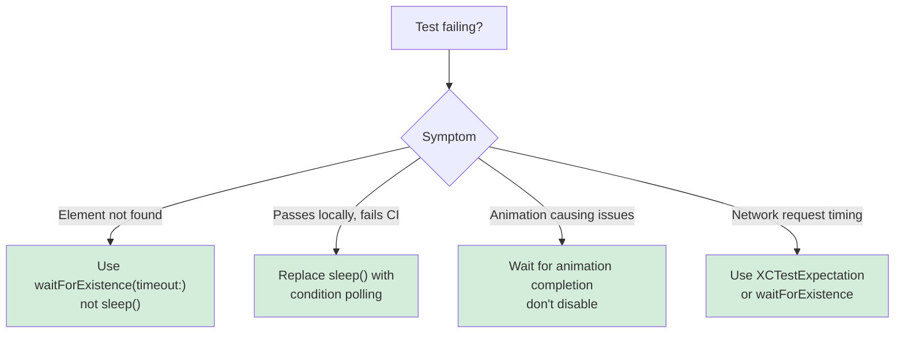

# UI Testing

Reliable UI tests built on condition-based waiting instead of fixed delays. Covers Recording UI Automation (Xcode 26), accessibility-first testing, multi-device and multi-language configurations, network conditioning, and testing resizable apps.

## When to Use

Use this skill when:
- You're writing UI tests for the first time
- Tests pass locally but fail in CI
- Tests use `sleep()` and are flaky
- You're recording interactions with Xcode 26's Recording UI Automation
- Tests fail on iPad but pass on iPhone
- You want to test under slow, lossy, or missing network connections
- You're testing a resizable app: the window-dimension matrix, right-to-left and pseudolocalization passes, and live resizing
- You want to assert what VoiceOver actually speaks for your UI, not just that a label exists (OS 27)
- You want to test your App Intents through the system from a UI test (OS 27)

**Core principle:** Wait for conditions, not arbitrary timeouts. Flaky tests come from guessing how long operations take.

## Example Prompts

Questions you can ask your assistant that will draw from this skill:

- "My UI tests pass locally on my Mac but fail in CI. How do I make them more reliable?"
- "My tests use sleep(2) and sleep(5) but they're still flaky."
- "I recorded a test using Xcode 26's Recording UI Automation. How do I debug failures?"
- "My test fails on iPad but passes on iPhone."
- "How do I write tests that aren't flaky?"
- "How do I test my app under slow network conditions?"
- "How do I test slow-network or offline behavior in CI without sudo or the Network Link Conditioner GUI?"
- "How do I run my UI tests in RTL with AppleLanguages?"
- "How do I test my app at different window sizes automatically?"
- "How do I drive VoiceOver from a UI test and check what it reads for my button?"
- "How do I test my App Intents without running them through Siri by hand?"

## What This Skill Provides

### Condition-Based Waiting
- `waitForExistence(timeout:)` instead of `sleep()`
- `XCTNSPredicateExpectation` for waiting on an element to disappear or reach a state, such as becoming enabled
- Waiting through animations on a real post-animation element, never a delay
- Timeouts that fit the work: 2–3 seconds for UI animations, 10 for network requests, 30 at most

### Recording UI Automation (Xcode 26)
- Three phases: record, replay, and review
- Accessibility identifiers as the foundation
- Choosing stable queries (identifiers over labels)
- Reviewing failures in video recordings with UI element overlays

### Accessibility-First Testing
- `.accessibilityIdentifier()` for stable element queries
- Avoiding hardcoded localized labels
- Reviewing elements with Accessibility Inspector
- `performAccessibilityAudit()` in tests
- `XCUIDevice.shared.voiceOverService` (OS 27) – moves the VoiceOver cursor so you can assert the spoken output

### App Intents (OS 27)
- AppIntentsTesting runs your intents out of process, through the same stack as Siri and Shortcuts, and checks their results
- It works only from a UI Testing Bundle, and the app must launch first so the system serves current intent metadata

### Test Plans
- Multiple device and language configurations
- Video and screenshot capture settings
- Right-to-left language testing
- Replaying tests in Xcode Cloud

### Network Conditioning
- An in-process `URLProtocol` harness that needs no sudo: latency and jitter, low bitrate, flaky or hard request failures, and offline, deterministic by default and CI-friendly
- Network Link Conditioner and `dnctl` for conditioning the whole Mac, plus the on-device profile for real hardware
- Optional toxiproxy for traffic the app's `URLSession` doesn't own; Axiom doesn't ship it, so the skill checks for it and falls back to the `URLProtocol` harness when it's missing
- Running the same tests across device sizes and network speeds to catch failures that need both

### Resizable Apps and Device Control
- A window-dimension matrix that covers sizes and the transitions between them, not device models
- Launch arguments for double-length strings, forced right-to-left layout, and real locales
- Which dimensions automate (including continuous resizing with `devicectl device appResize`) and which need real hardware, such as iPhone Mirroring
- `devicectl` from CI, including Face ID enrollment and matching on a simulator

### Debugging Test Failures
- A video review workflow
- The UI element overlay at the point of failure
- Crash log analysis for crashes that UI tests reveal
- Concurrency bugs the tests expose, and stress tests that verify the fix

## Key Pattern

### Condition-Based Waiting

```swift
// ❌ WRONG — Arbitrary timeout
func testButtonAppears() {
    app.buttons["Login"].tap()
    sleep(2)  // Guessing it takes 2 seconds
    XCTAssertTrue(app.buttons["Dashboard"].exists)
}

// ✅ CORRECT — Wait for condition
func testButtonAppears() {
    app.buttons["Login"].tap()
    let dashboard = app.buttons["Dashboard"]
    XCTAssertTrue(dashboard.waitForExistence(timeout: 5))
}
```

### Accessibility Identifiers

```swift
// In app code
Button("Submit") { }
    .accessibilityIdentifier("submitButton")

// In test code — stable across localizations
let submitButton = app.buttons["submitButton"]
XCTAssertTrue(submitButton.waitForExistence(timeout: 5))
```

### Decision Tree



## Documentation Scope

This page documents the `ui-testing` skill (in the `axiom-testing` suite), which your assistant draws on when you write or debug XCTest UI tests. For test-driven development methodology, the skill defers to the `test-driven-development` skill in the separate Superpowers plugin.

- For the full AppIntentsTesting API, parameter rules, and error reference, see [app-intents-ref](/reference/app-intents-ref)
- For `devicectl`, Device Hub, and the simulator subcommand matrix, see [device-control-ref](/reference/device-control-ref)

## Related

- [ui-recording](/skills/testing/ui-recording) – A focused guide to recording UI tests in Xcode 26
- [xctest-automation](/skills/testing/xctest-automation) – Element identification, test isolation, and CI/CD integration for XCUITest
- [swift-testing](/skills/testing/swift-testing) – Swift Testing patterns for the unit tests beneath your UI tests
- [xcui-ref](/reference/xcui-ref) – Axiom's simulator tool for toggling Dynamic Type and checking the accessibility tree
- [test-failure-analyzer](/agents/test-failure-analyzer) – Agent that diagnoses why a specific test is flaky or fails only in CI
- [swift-concurrency](/skills/concurrency/swift-concurrency) – Main-actor and async patterns behind crashes that UI tests reveal
- [xcode-debugging](/skills/debugging/xcode-debugging) – Environment diagnostics when tests fail because of Xcode itself

## Resources

**WWDC**: 2022-110371, 2023-10035, 2023-10175, 2023-10278, 2024-10179, 2025-344

**Docs**: /xctest, /xcuiautomation/recording-ui-automation-for-testing, /xctest/xctwaiter, /accessibility/delivering_an_exceptional_accessibility_experience, /accessibility/performing-accessibility-testing-for-your-app
